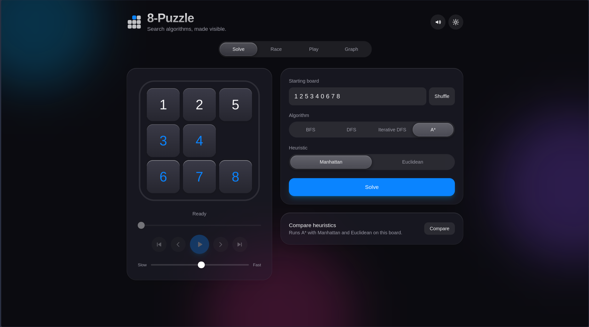
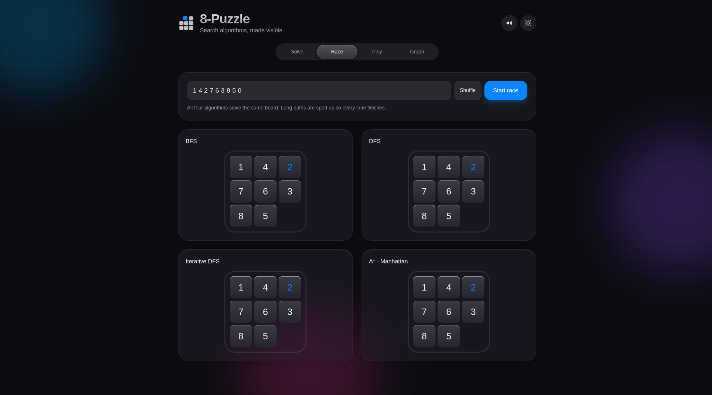
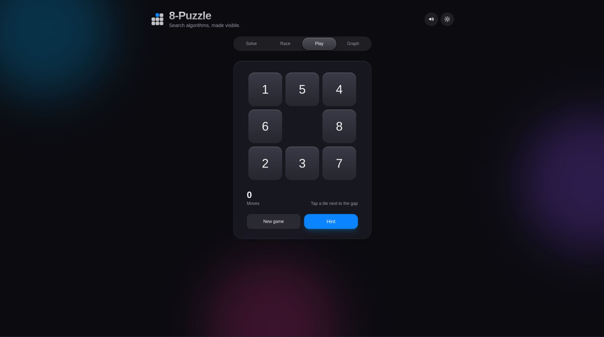
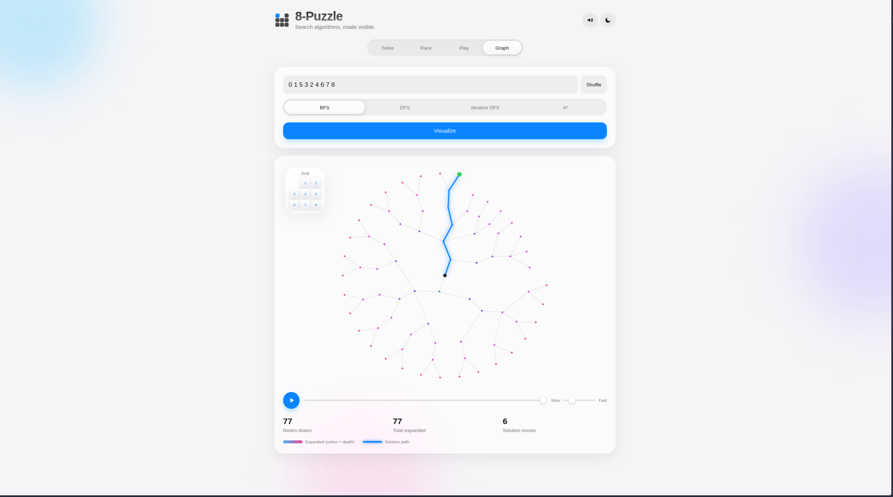
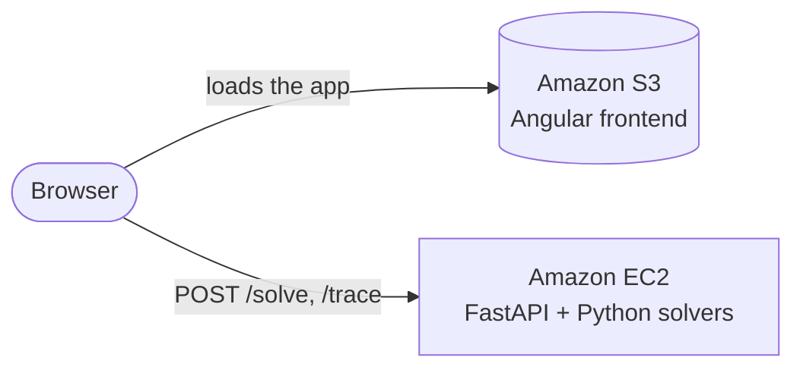

<div align="center">

# 8-Puzzle: Search Algorithms, Made Visible

**Watch BFS, DFS, Iterative DFS and A\* solve the 8-puzzle, race each other, and grow their search trees live.**

[](https://angular.dev)
[](https://tailwindcss.com)
[](https://fastapi.tiangolo.com)
[](https://www.python.org)
[](https://aws.amazon.com)

### [**Try it live →**](http://frontend-demo-ai-lab1.s3-website.eu-north-1.amazonaws.com/)


</div>

---

## About

This is **Assignment 1** of the Artificial Intelligence course at Alexandria University, Faculty of Engineering (Computer and Systems Program). The task is to solve the 8-puzzle with both uninformed and informed search algorithms and to compare how they behave.

Instead of printing steps in a terminal, this project turns the assignment into an interactive app: a **Python/FastAPI** backend runs the search algorithms, and an **Angular + Tailwind CSS** frontend with a minimal, glass-style design shows everything the algorithms do.

> **Live demo:** the app is deployed on **AWS**, with the frontend on **Amazon S3** and the backend on **Amazon EC2**. Use the link above to try it in your browser.
>
> *The demo runs on an AWS Free Tier account, so it may go offline once that plan ends. The instructions below let you run the whole project locally.*

## Features

| | |
|---|---|
| **Solve** | Pick an algorithm, press *Solve*, and watch the tiles slide along the solution path. A progress ring fills as the solution plays, with play, pause, step, scrub and speed controls. |
| **Race** | All four algorithms solve the same board side by side. Cost, nodes expanded and running time are shown live, and the best value in each row is highlighted. |
| **Play** | Solve the puzzle yourself by tapping tiles. Press **Hint** and the A\* backend finds the best next move from your current position. |
| **Graph** | A live visualization of the search itself. Every expanded node appears in order, coloured by depth, and the final solution path lights up at the end. |
| **Extras** | Dark mode, sound effects, confetti on completion, and a Manhattan vs Euclidean heuristic comparison. |

## Screenshots

<table>
  <tr>
    <td align="center"><b>Solve</b><br></td>
    <td align="center"><b>Race</b><br></td>
  </tr>
  <tr>
    <td align="center"><b>Graph (live search tree)</b><br></td>
    <td align="center"><b>Play (with hints)</b><br></td>
  </tr>
  <tr>
    <td align="center" colspan="2"><b>Dark mode</b><br></td>
  </tr>
</table>

## Algorithms

| Algorithm | Type | Frontier | Optimal? | Notes |
|---|---|---|---|---|
| **BFS** | Uninformed | Queue (FIFO) | Yes | Expands level by level, so it finds the shortest path but uses a lot of memory. |
| **DFS** | Uninformed | Stack (LIFO) | No | Dives deep first. It is fast to start but can return very long paths. |
| **Iterative DFS** | Uninformed | Stack with a depth limit | Yes | Repeats depth-limited DFS with a growing limit, combining DFS memory use with BFS optimality. |
| **A\*** | Informed | Priority queue ordered by `f = g + h` | Yes (admissible `h`) | Uses a heuristic to head toward the goal. |

All four algorithms keep a set of visited states so no board is expanded twice, and every move costs 1, so the path cost equals the number of moves.

### Heuristics for A\*

| Heuristic | Formula (per tile, summed over all tiles) |
|---|---|
| **Manhattan** | `\|x − x_goal\| + \|y − y_goal\|` |
| **Euclidean** | `√((x − x_goal)² + (y − y_goal)²)` |

Both heuristics are **admissible**, because they never overestimate the true remaining cost, so A\* stays optimal with either. Manhattan is always at least as large as Euclidean, which makes it the **more informed** one: it expands fewer nodes to reach the same optimal path. The *Race* and *Solve → Compare heuristics* views let you see this on any board.

### Sample run

Starting from `1,2,5,3,4,0,6,7,8` (the example from the assignment), BFS, Iterative DFS and A\* all find the optimal 3-move solution:

```
Up → Left → Left        cost = 3
```

## Architecture



- **Frontend:** Angular (standalone components and signals) with Tailwind CSS. The animated board is shared by every view, and the search tree is drawn on an HTML canvas with a radial tree layout.
- **Backend:** FastAPI with Pydantic validation. Boards that cannot be solved (odd number of inversions) are rejected before any search starts.

### API

**`POST /solve`** runs a search and returns the full solution.

```jsonc
// request
{ "initstate": "125340678", "algorithm": "A_Star", "h_type": "manhattan" }

// response
{
  "path_to_goal": ["up", "left", "left"],
  "states": ["125340678", "125304678", "..."],   // the board after every move
  "cost_of_path": 3,
  "nodes_expanded": 7,
  "search_depth": 3,
  "running_time": 0.42                             // milliseconds
}
```

`algorithm` is one of `BFS`, `DFS`, `Iterative_DFS`, `A_Star`. `h_type` (`manhattan` or `euclidean`) is required only for `A_Star`. The board is a string of the digits 0–8, with `0` as the blank.

**`POST /trace`** takes the same request and returns the expanded nodes in order (`state`, `parent`, `depth`, `on_path`) for the Graph view. Large searches are truncated to the first 1500 expansions, and the solution path is always included in full.

Interactive API docs are available at `/docs` when the backend is running.

## Run it locally

**Backend** (Python 3.10+)

```bash
cd backend
pip install fastapi uvicorn
uvicorn main:app --reload
```

**Frontend** (Node.js 20+)

```bash
cd frontend
npm install
ng serve                           # http://localhost:4200
```

## Project structure

```
.
├── backend/
│   ├── main.py              # FastAPI app: /solve and /trace
│   ├── tools.py             # moves, goal test, heuristics
│   ├── BFS.py  DFS.py  Iterative_DFS.py  A_star.py
│   └── schema/              # Node, Input, Response, Trace
├── frontend/
│   └── src/app/
│       ├── app.ts / app.html        # shell: tabs, theme, sound
│       ├── solve-view.*             # solve + playback
│       ├── race-view.ts             # four-lane race
│       ├── play-view.ts             # play yourself + hints
│       ├── search-view.ts           # live search-tree graph
│       ├── puzzle-board.ts          # shared animated board
│       └── solver.service.ts        # API client
└── assets/        # images used in this README
```


*Alexandria University, Faculty of Engineering, Computer and Systems Program, Artificial Intelligence Course, October 2026.*